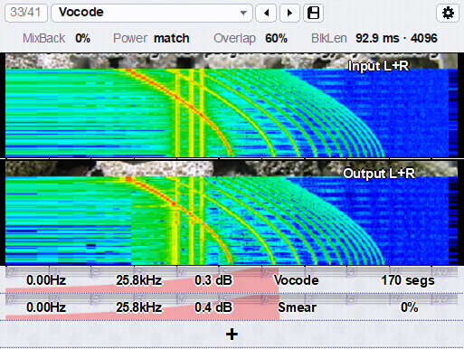
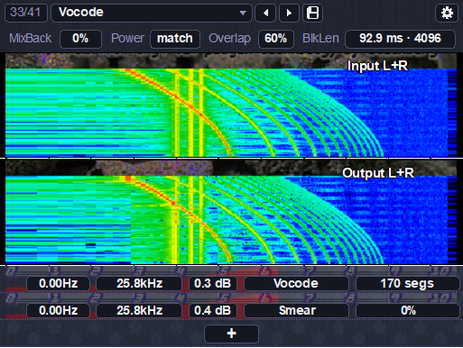

# DtBlkFix

DtBlkFx, fixed.

<p>
  
  
</p>

**[Download DtBlkFix 1.0.0](https://github.com/kadspace/dtblkfix/releases/latest)**: free, Windows 64-bit VST3.

DtBlkFx is Darrell Tam's FFT effect from 2005–2006: up to eight spectral effects in series, from harmonic filtering and pitch tracking to vocoding and contrast. There's still nothing quite like it, but a few things make it hard to use today. DtBlkFix fixes those and leaves the rest alone. It runs the same engine and sounds the same, and the original presets still work.

## Fixed

- **Timing.** DtBlkFx delayed its output by one block but told the host its latency was zero, so at the default settings everything came out a beat late. DtBlkFix always delays by exactly one block and reports it, so the host compensates for it, and the Delay control is gone.
- **Song sync.** DtBlkFx checked the song position about once a beat, and only with Sync on, so after a loop, a jump or a tempo change the blocks drifted off the beat, and where they landed depended on the host's buffer size. In DtBlkFix, Sync is always on, so its control is gone, and blocks follow the song position on every buffer: a block starts on every beat, right after a loop or jump, at any buffer size. With no song position, there's no beat to follow.
- **Window size.** The original is a fixed 410 by 409 pixel window, which is tiny on a modern screen. In DtBlkFix you drag the window to any size and shape, and the editor scales to fill it (from 75 to 300%), or you pick 75, 100, 125, 150 or 200% in the settings. Text and lines are drawn at the new size, so it stays sharp.
- **Skins.** The original look, plus Dark and Warm. A skin is just the folder of images the plugin already loads, so you can make your own.
- **Easier to read.** Style **Boxes** puts each value in a box, in the top strip and the effect rows. **Original** keeps DtBlkFx's outlined text.
- **Presets and settings at the top.** A bar across the top of the editor shows the preset: its number, its name (click it for the list), ← → for the previous and next, and a save button for your own presets. The gear at the right opens the settings: Size, Skin (Original, Dark, Warm) and Style.
- **Effect rows.** The original always showed eight effect rows, most of them empty. DtBlkFix shows only the effects in use. **+** below them adds one, and the **×** at the left end of a row removes it.
- **Format.** DtBlkFix is a 64-bit VST3.

Apart from Sync, the audio is bit-identical to the original. That's the whole list. There are no new effects. The only new controls are the preset bar (with saving your own presets), + and ×, and Size, Skin and Style; Delay and Sync are gone, and BlkLen shows the block length in ms and samples.

## Installing

Windows 10 or later, 64-bit.

Download `DtBlkFix.vst3` from the [latest release](https://github.com/kadspace/dtblkfix/releases/latest) and copy it into your VST3 folder, usually `C:\Program Files\Common Files\VST3`. Then rescan plugins in your DAW. It's one file with everything it needs inside, its licenses included. The first time it loads, it unpacks them to `%LOCALAPPDATA%\DtBlkFix.0.0`.

DtBlkFix has its own plugin ID, so it installs next to the original DtBlkFx and doesn't replace it. It has the same presets and saves its settings in the same format.

## Presets, effects, size, skin and style

The bar at the top shows the preset. Click ← or → for the previous or next one, or click its name for the list. **Reset this preset**, at the end of the list, puts the current preset back as it was.

To save your own, click the save button next to the arrows, type a name and press Enter (Escape cancels). Your presets are listed under **User**, after the factory ones, and ← → go through them too. Each is a small text file in `Documents\DtBlkFix\Presets`, so you can back them up or share them; saving under a name that's already there replaces it, and deleting the file deletes the preset.

Each row is an effect, run in order from the top. Click **+** below the last row to add one: it starts as a Filter over the whole range at 0 dB, which leaves the sound alone until you change it. Hover over a row and click the **×** at its left end to remove it; the effects below move up. An effect counts as in use if any of its settings isn't zero, which is what an empty slot is in the presets.

Drag the bottom right corner (or the window's edge, if your DAW allows it) to any size and shape: the editor scales to the largest size that fits, and redraws sharp when you stop. The gear at the top right opens the settings in place of the spectrograms: **Size**, **Skin** (Original, Dark or Warm) and **Style** (Original, or Boxes, which is easier to read). A change applies straight away; click the gear again to go back. Size, skin and style are saved with the plugin's state.

To make a skin, copy the `stereo_*.png` files from `%LOCALAPPDATA%\DtBlkFix.0.0\dtblkfx` into a new folder in its `skins` folder, keep their sizes, and edit them. The folder's name is the skin's name. The Dark and Warm skins are made from the originals by [`tools/make_skins.py`](tools/make_skins.py).

## Building

You need Windows, Visual Studio 2022 or later, CMake 3.22 or later, Python 3, a [JUCE 8](https://github.com/juce-framework/JUCE) checkout and the [64-bit FFTW 3.3.5 DLLs](https://www.fftw.org/install/windows.html).

```
cmake -S . -B build -A x64 -DDTBLKFIX_JUCE_DIR=<JUCE> -DDTBLKFIX_FFTW_DIR=<folder with libfftw3f-3.dll>
cmake --build build --config Release
ctest --test-dir build -C Release
```

The VST3 ends up in `build/plugin/DtBlkFix_artefacts/Release/VST3`, as a bundle whose `Contents/x86_64-win/DtBlkFix.vst3` is the single-file plugin: with `DTBLKFIX_FFTW_DIR` set, the `dtblkfx` folder and the licenses are packed into it by [`tools/pack_resources.py`](tools/pack_resources.py). [`packaging/package.ps1`](packaging/package.ps1) copies it out for release. CMake also builds a standalone app, which CI uses for a resize test. The comparison against the original engine runs when `DTBLKFIX_REFERENCE_DIR` points to a checkout of it; [`.github/workflows/build.yml`](.github/workflows/build.yml) shows how CI does it, packaging included.

The plugin doesn't need the Steinberg VST2 SDK: `shim/` stands in for the few parts of it that the engine uses. If you have the SDK, `projects/DTBlkFx.sln` still builds the VST2: copy its `pluginterfaces/` and `public.sdk/` folders into `vstsdk/`, then open the solution or run `build_fork.bat`.

## Credits

DtBlkFx was written by Darrell Tam. This repo starts from the [dozius fork](https://github.com/dozius/dtblkfx), which got the source building for x64 and has since moved off GitHub. DtBlkFix isn't affiliated with or endorsed by either of them. The original manual is in [`docs/manual.html`](docs/manual.html), and the fork's readme is in [`docs/dtblkfx-readme.md`](docs/dtblkfx-readme.md).

## License

GPLv3, see [`LICENSE`](LICENSE). The plugin binaries are built with JUCE 8 under the AGPLv3. Bundled third-party code and its licenses are listed in [`THIRD_PARTY_NOTICES.md`](THIRD_PARTY_NOTICES.md).
